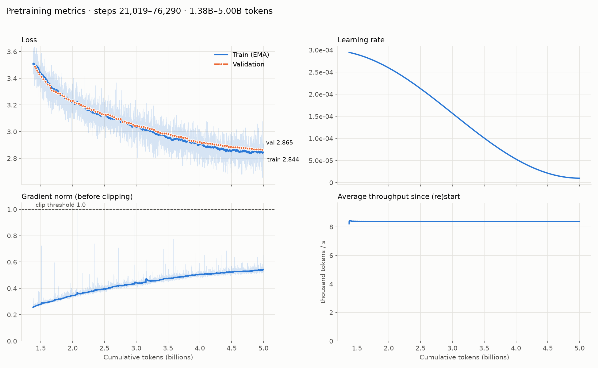

# Qwen3-0.6B 从零预训练：5B token 阶段报告

单卡 RTX 4090 D（24GB），在 FineWeb-Edu `sample-10BT` 上从随机初始化训练 Qwen3-0.6B 架构，累计 5B token，2026-11-18 完成。

## 结论

- 最终验证 loss **2.865**（困惑度约 17.6），训练 loss 平滑值 **2.844**。两者全程只差约 0.02，没有过拟合，符合每条数据只看一遍的设定。
- 到 5B 时 loss 仍在下降，只是变慢。按 Chinchilla 经验（约 20 token/参数），0.6B 模型约需 12B token，继续 extend 仍有收益。
- 训练全程稳定：梯度范数平滑上升，没有持续的尖峰；吞吐量 5 天内恒定在约 8.37k tokens/s。
- 前 21018 步（约 1.38B token）使用纯 BF16 参数，RMSNorm 权重实际上没有被训练；之后改为 FP32 主权重。详见下文“精度问题”。

## 训练设置

| 项目 | 值 |
|---|---|
| 模型 | Qwen3 架构，28 层，hidden 1024，16 个注意力头 / 8 个 KV 头，词表 151,936，共享输入输出嵌入，参数 596,049,920（[model_config.json](model_config.json)） |
| 初始化 | 随机初始化，只沿用 Qwen3-0.6B 的结构配置和 tokenizer |
| 数据 | FineWeb-Edu（`HuggingFaceFW/fineweb-edu`）`sample/10BT` 前 10 个 parquet（`000`–`009`）；文档间用 `<\|endoftext\|>`（151643）分隔，打包为 2048 长度窗口（[data_meta.json](data_meta.json)） |
| 每步 token | 2048 × batch 2 × 梯度累积 16 = 65,536 |
| 优化器 | AdamW，betas (0.9, 0.95)，eps 1e-8，weight decay 0.1（仅作用于矩阵和嵌入），梯度裁剪 1.0 |
| 精度 | 1.38B 起为 FP32 主权重 + BF16 autocast；此前为纯 BF16 |
| 验证集 | 固定 100k token，每 500 步评估 10 个 batch |
| 环境 | torch 2.7.1+cu118，transformers 4.57.6（[requirements-lock.txt](requirements-lock.txt)） |

## 训练阶段

| 阶段 | 步数 | 累计 token | 学习率 | 说明 |
|---|---|---|---|---|
| 1B 预训练 | 0 – 15,259 | 0 – 1.0B | 3e-4 余弦衰减至约 1e-5 | 数据 `prepared_1b_parallel`，旧脚本，纯 BF16 |
| 5B 延续（前段） | 15,259 – 21,018 | 1.0B – 1.38B | 从 1e-5 热身 500 步回到 3e-4 | 新数据 `prepared_next4b_parallel`（跳过前 1B 已用文档，验证集沿用），旧脚本，纯 BF16 |
| 5B 延续（后段） | 21,018 – 76,294 | 1.38B – 5.0B | 余弦衰减 3e-4 → 1e-5 | 重构后代码，FP32 主权重，学习率曲线按原计划无缝续接（[run.json](run.json)） |

[metrics.jsonl](metrics.jsonl) 只覆盖最后一段（1.38B – 5B）：它是重构后才加入的记录方式。前两段的 loss 只输出在旧脚本的终端日志里，没有保存在这个目录中。

## 各阶段指标

验证 loss 取最接近该 token 数的一次评估；训练 loss 为该点起 0.1B token 内的平均值。

| 累计 token | 步数 | 验证 loss | 训练 loss | milestone |
|---|---|---|---|---|
| 1.41B | 21,500 | 3.489 | 3.474 | |
| 2.0B | 30,500 | 3.231 | 3.210 | [tokens_2000000000](milestone_info/tokens_2000000000.json) |
| 3.0B | 46,000 | 3.045 | 3.024 | [tokens_3000000000](milestone_info/tokens_3000000000.json) |
| 4.0B | 61,000 | 2.922 | 2.890 | [tokens_4000000000](milestone_info/tokens_4000000000.json) |
| 5.0B | 76,000 | 2.865 | 2.847 | [tokens_5000000000](milestone_info/tokens_5000000000.json) |

每增加 1B token，验证 loss 的降幅依次为 0.19、0.12、0.06。收益递减，一部分来自学习率在末段衰减到很小。

## 稳定性

- **梯度范数**：从约 0.27（前 100 条记录均值）平滑升至约 0.54（最后 100 条）。学习率衰减阶段出现这种上升很常见。日志每 10 步记录一次，5,529 条记录中只有 2 条超过裁剪阈值 1.0，最大为 1.67（step 48,120，约 3.15B token），随后立即回落，loss 没有对应的尖峰。
- **数值**：没有出现 NaN 或 inf。训练代码在梯度或 loss 非有限时会在更新参数前中止，这一保护全程没有触发。
- **吞吐量**：平均约 8,371 tokens/s，1.38B → 5B 共约 120 小时（5 天）；峰值显存约 16.6GiB。

## 精度问题：前 1.38B 的 BF16 参数

前两段使用纯 BF16 参数和 BF16 优化器状态。BF16 只有 8 位尾数，参数值约为 1.0 时，最小可表示的变化约为 0.008，远大于一次更新的步长（约 lr × 1 ≈ 3e-4），更新被舍入为零。

在服务器上比较 step 21,000 和 21,018 的 checkpoint 时发现：

- 所有 RMSNorm 权重的变化比例为 **0.00%**，仍是初始值 1.0，即从未被训练；
- 注意力投影矩阵（如 `q_proj`）约 78% 的元素有变化，但在学习率衰减后，这一比例还会继续下降；
- weight decay 对 BF16 参数同样会被舍入掉。

从 step 21,018 起改为 FP32 主权重 + BF16 autocast，优化器状态无损迁移，学习率曲线不变。**尚未验证**：改为 FP32 后 RMSNorm 权重是否确实开始变化，可以对比 2B 与 5B milestone 中 `*norm.weight` 的取值来确认。

## 局限

- 验证集只有 100k token，每次评估 10 个 batch（约 41k token），单次数值有约 ±0.01 的噪声，适合看趋势，不适合比较很小的差异。
- 只有 loss 指标。尚未用 `python -m qwen_pretrain evaluate` 对各 milestone 做事实题、语法题等探针评估。
- 0 – 1.38B 的逐步曲线没有保存在这里。
- 本机备份只有 2B – 5B 的 milestone 权重；1B milestone 只在服务器上。

## 文件

| 文件 | 内容 |
|---|---|
| [metrics.png](metrics.png) | 训练曲线，由 `python tools/plot_metrics.py metrics.jsonl --output metrics.png` 生成 |
| [metrics.jsonl](metrics.jsonl) | 1.38B – 5B 的逐 10 步训练记录和每 500 步验证记录 |
| [run.json](run.json) | 最后一段的完整配置和学习率曲线参数 |
| [data_meta.json](data_meta.json) | 4B 延续数据的来源文件、token 数和与 1B 数据的衔接 |
| [model_config.json](model_config.json)、[generation_config.json](generation_config.json) | 模型结构配置 |
| [milestone_info/](milestone_info/) | 2B – 5B milestone 的步数和实际 token 数 |
| [requirements-lock.txt](requirements-lock.txt) | 训练服务器的完整依赖版本 |

模型权重（milestone `.safetensors`，每个约 1.5GB）和完整 checkpoint（约 7.2GB）不放入仓库。

## 下一步

- SFT：在 `HuggingFaceTB/smol-smoltalk` 上训练 1 个 epoch（`posttrain/sft.py`），进行中。
- 对 1B – 5B milestone 运行 `evaluate`，补充探针评估结果。
- 可选：继续 extend 预训练到 10B 以上。
